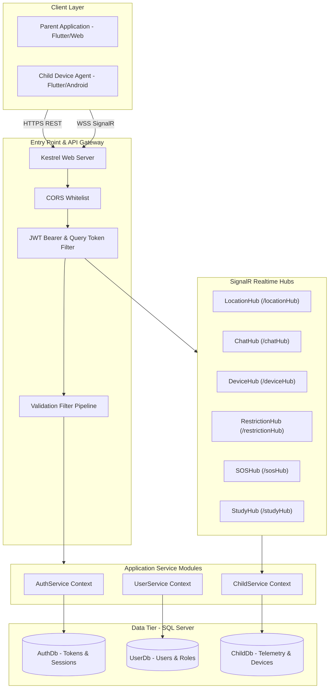

<div align="center">

# QLTE Enterprise Platform API

### Enterprise-Grade Child Safety, Telemetry Monitoring, and Parental Control Backend Service

[](https://dotnet.microsoft.com/)
[](https://docs.microsoft.com/en-us/dotnet/csharp/)
[](https://dotnet.microsoft.com/apps/aspnet)
[](https://dotnet.microsoft.com/apps/aspnet/signalr)
[](https://www.microsoft.com/sql-server)
[]()
[](LICENSE)

[Project Overview](#1-project-overview) • [Core Capabilities](#2-core-capabilities) • [Feature Matrix](#3-role-based-feature-matrix) • [Architecture](#4-application-architecture) • [Quickstart](#5-quickstart-guide) • [Documentation Hub](#6-documentation-hub) • [Deployment](#7-deployment-and-packaging) • [License](#8-license)

</div>

---

> [!IMPORTANT]
> **Production Configuration & Runtime Pre-requisites**
> 1. **Runtime Requirements**: Ensure .NET 8.0 SDK or ASP.NET Core Runtime 8.0 Hosting Bundle is installed on the target host.
> 2. **Database Provisioning**: The backend requires Microsoft SQL Server instances configured for `AuthDb`, `UserDb`, and `ChildDb`. Connection strings must be configured in environment variables or `appsettings.json` prior to execution.
> 3. **Reverse Proxy & WebSocket Upgrades**: SignalR hubs require HTTP/1.1 with explicit `Upgrade` and `Connection` headers forwarded to the Kestrel server. Set proxy read/write timeouts to at least 86400 seconds to prevent abrupt connection termination.
> 4. **JWT Cryptographic Integrity**: Configure a cryptographically secure `AuthOptions:Jwt:SecretKey` with a minimum length of 32 characters in production environments.

---

## 1. Project Overview

The **QLTE Enterprise Platform** is a distributed, high-throughput backend system designed to ensure child safety, real-time geofence enforcement, device usage governance, and emergency response orchestration. 

### 1.1 The Real-World Problem
Modern digital environments present critical safety risks for children:
- Physical safety risks when children navigate outside trusted perimeters or enter hazardous zones.
- Unmonitored digital device over-exposure, unrestricted access to harmful online content, and academic distractions.
- Delayed emergency notifications during acute distress situations due to fragmented communication channels.

### 1.2 The Architectural Solution
QLTE provides a unified, enterprise-grade backend infrastructure featuring:
- High-frequency GPS telemetry streaming with sub-second mathematical geofence verification via the Haversine formula.
- Centralized policy distribution that coordinates with native Android services to enforce application whitelisting and DNS firewall blocking.
- Realtime WebRTC signaling and messaging pipelines connecting parents and children securely without relying on third-party public brokers.
- A decoupled Modular Monolith design that isolates authentication, user governance, and child telemetry workloads.

---

## 2. Core Capabilities

### 2.1 Real-Time Geolocation Tracking & Geofencing Engine
- **Telemetry Ingestion**: Continuous coordinate streaming via SignalR (`LocationHub`) persisted into audit-ready location tables.
- **Dynamic Geofence Verification**: Mathematical evaluation against customizable circular boundaries (`SafeZone` and `DangerZone`).
- **Instant Boundary Breach Escalation**: Automatic status transitions and immediate push notifications dispatched to parents the moment a child exits safe coordinates.

### 2.2 Device Governance and Firewall Enforcement
- **Remote Lock & Screen Time**: Administrative lock triggers (`PUT /api/DeviceInfo/LockDevice/{childId}`) that propagate instantly to child devices.
- **Application & Content Blacklisting**: Centralized configuration of blacklisted packages and web domains.
- **Local Firewall Coordination**: Bi-directional signaling via `RestrictionHub` enabling parents to activate "Study Mode" and toggle local VPN filtering on demand.

### 2.3 Emergency SOS Alarm Multiplexing
- **One-Touch Alarm Dispatch**: Child devices trigger high-priority SOS payloads containing precise GPS coordinates, battery level, and contextual notes.
- **SignalR Broadcast Fanout**: Instant delivery to all parent devices enrolled in the child group, bypassing standard polling intervals.

### 2.4 Secure Messaging & WebRTC Peer-to-Peer Signaling
- **Internal Messaging**: Authenticated chat system supporting read receipts and chronological transcript querying.
- **WebRTC Signaling Gateway**: Secure exchange of Session Description Protocol (SDP) offers, answers, and Interactive Connectivity Establishment (ICE) candidates for end-to-end audio/video streaming.

### 2.5 Identity, RBAC, and Token Rotation
- **Dual-Token Architecture**: Short-lived JWT access tokens paired with rotated refresh tokens stored in SQL Server.
- **External Identity Federation**: Cryptographic verification of Google OAuth2 ID tokens via Google Public Certificates.
- **Transactional Notifications**: Automated email verification and OTP password recovery powered by MailKit.

---

## 3. Role-Based Feature Matrix

The table below delineates the access boundaries enforced across system actors:

| Functional Scope | Administrator | Parent | Children | Anonymous |
|---|---|---|---|---|
| User Enrollment & Local Login | Supported | Supported | Supported | Supported |
| External Identity Login (Google OAuth) | Supported | Supported | Supported | Supported |
| Token Refresh & Revocation | Supported | Supported | Supported | Supported |
| User Profile & Avatar Updates | Supported | Supported | Supported | Not Applicable |
| Global User Directory Administration | Supported | Not Applicable | Not Applicable | Not Applicable |
| Role Definition & Policy Configuration | Supported | Not Applicable | Not Applicable | Not Applicable |
| Child Profile Registration & Assignment | Supported | Supported | Not Applicable | Not Applicable |
| Geofence Zone Management (Safe/Danger) | Supported | Supported | Not Applicable | Not Applicable |
| Realtime GPS Telemetry Ingestion | Supported | Supported | Supported | Not Applicable |
| Remote Device Locking / Unlocking | Supported | Supported | Not Applicable | Not Applicable |
| Study Mode & Firewall Policy Toggle | Supported | Supported | Not Applicable | Not Applicable |
| Device Battery & Heartbeat Reporting | Supported | Supported | Supported | Supported |
| Emergency SOS Activation | Supported | Supported | Supported | Not Applicable |
| WebRTC Audio/Video Signaling Mediation| Supported | Supported | Supported | Not Applicable |

---

## 4. System Highlights

| Capability | Module / Service | Technical Description |
|---|---|---|
| Identity & Token Rotation | `AuthService` | Issues JWT Bearer tokens with HMAC-SHA256 signatures, manages persistent refresh tokens, and verifies external Google OAuth2 tokens. |
| User & Profile Management | `UserService` | Encapsulates user accounts, ASP.NET Core Identity integration, avatar management, and role-based policy enforcement. |
| Child Telemetry & Geofencing | `ChildService` | Implements Haversine distance calculations, coordinate history tracking, circular zone evaluations, and device inventories. |
| Realtime SignalR Gateway | `Backend_QLTE.Hubs` | Multiplexes 6 bidirectional WebSocket hubs (`ChatHub`, `LocationHub`, `DeviceHub`, `RestrictionHub`, `SOSHub`, `StudyHub`). |
| Media Storage & Localization | `Shared.FileStorage` | Provides MIME-type validation, static media persistence in `wwwroot`, and Vietnamese diacritic slugification. |

---

## 5. Application Architecture



---

## 6. Quickstart Guide

### Step 1: Clone Repository and Configure Environment
Clone the repository and prepare the environment configuration file:

```bash
git clone https://github.com/hoangfhisp/QLTE_API.git
cd QLTE_API
cp .env.example .env
```

Review and configure your database connection parameters within `.env` or `Backend_QLTE/appsettings.json`:

```json
{
  "ConnectionStrings": {
    "AuthDb": "Server=localhost,1433;Database=QLTE_AuthDb;User Id=sa;Password=YourPassword123!;TrustServerCertificate=True;",
    "UserDb": "Server=localhost,1433;Database=QLTE_UserDb;User Id=sa;Password=YourPassword123!;TrustServerCertificate=True;",
    "ChildDb": "Server=localhost,1433;Database=QLTE_ChildDb;User Id=sa;Password=YourPassword123!;TrustServerCertificate=True;"
  },
  "AuthOptions": {
    "Jwt": {
      "SecretKey": "SuperSecretKeyWithMinimumLengthOf32Characters!",
      "Issuer": "QLTE_API",
      "Audience": "QLTE_Clients",
      "ExpireMinutes": 60
    },
    "RefreshTokenExpireDays": 15
  }
}
```

### Step 2: Restore Dependencies and Apply Migrations
Restore project packages and execute database migrations:

```bash
dotnet restore Backend_QLTE.sln

cd Backend_QLTE
dotnet ef database update --context UserDbContext
dotnet ef database update --context ChildDbContext
cd ..
```

### Step 3: Run Application
Execute the API service using the .NET CLI:

```bash
# Development profile with Swagger UI enabled
dotnet run --project Backend_QLTE/Backend_QLTE.csproj
```

Once running, navigate to the local Swagger UI endpoint to inspect API specifications:
- **HTTP**: `http://localhost:5000/swagger`
- **HTTPS**: `https://localhost:5001/swagger`

---

## 7. Documentation Hub

Comprehensive architectural, operational, and integration documentation is maintained within the `docs/` directory:

| Document | Technical Domain | Key Subjects |
|---|---|---|
| [System Design](docs/SYSTEM_DESIGN.md) | Architecture & Workflows | Modular Monolith layout, domain contexts, and sequence diagrams. |
| [Realtime Pipeline](docs/REALTIME_OR_DATA_PIPELINE.md) | Realtime & Telemetry | SignalR Hub protocols, WebSockets, WebRTC signaling, and Haversine geofencing. |
| [Native & Integration Engine](docs/NATIVE_OR_INTEGRATION_ENGINE.md) | Device & Cloud Integrations | Android VPN/Firewall service, Google OAuth2, and MailKit SMTP engine. |
| [API Specification](docs/API_SPECIFICATION.md) | RESTful API Reference | Complete inventory of HTTP methods, routes, access roles, and operations. |
| [State and Security](docs/STATE_AND_SECURITY.md) | Security & Governance | JWT token lifecycle, refresh token rotation, RBAC, CORS, and data protection. |
| [Deployment Guide](docs/DEPLOYMENT_GUIDE.md) | Production Operations | Docker containers, Docker Compose, Nginx reverse proxy, and EF Core migrations. |

---

## 8. Deployment and Packaging

The backend service supports multiple containerized and bare-metal production deployment strategies:

### 8.1 Docker & Docker Compose
The system can be initialized with Microsoft SQL Server using Docker Compose:
```bash
docker compose up -d --build
```

### 8.2 Production Compilation (.NET CLI)
```bash
dotnet publish Backend_QLTE/Backend_QLTE.csproj -c Release -o ./publish --no-self-contained
```

---

## 9. License

This project is licensed under the terms of the [MIT License](LICENSE).
