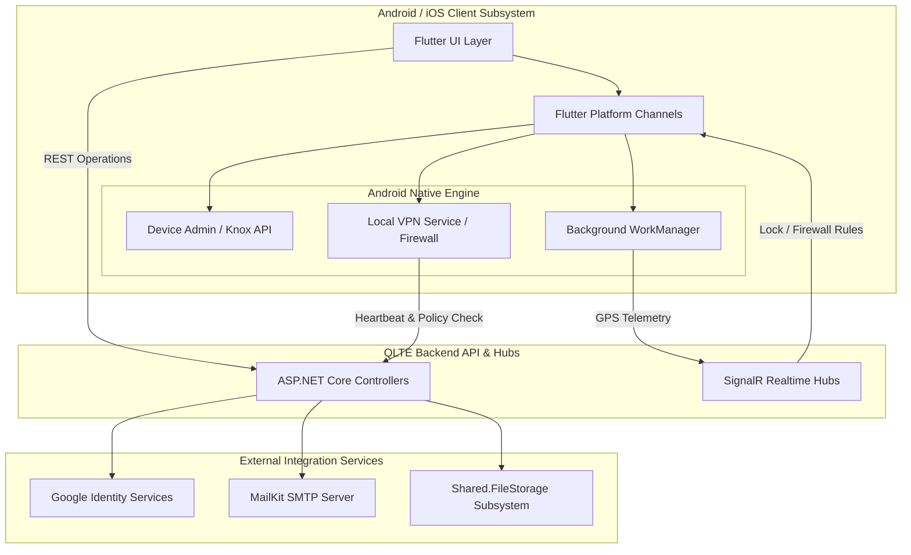

# Native Client and Integration Engine

## 1. Overview
The QLTE server interacts directly with Flutter mobile applications and native Android background services. This document outlines the technical mechanisms governing device administration, background telemetry, local firewall enforcements, and external third-party integrations.

---

## 2. Native Mobile Integration Architecture

### 2.1 Background WorkManager and Geolocation
- **Telemetry Frequency**: Position reporting operates at configurable intervals (e.g., 30s to 120s based on motion detection).
- **Execution Resilience**: The client utilizes native `WorkManager` (Android) and `BackgroundFetch` (iOS) combined with foreground services displaying a persistent status notification to prevent process termination by OS battery optimization engines.
- **Payload Structure**: Each GPS packet contains latitude, longitude, altitude, accuracy radius, and battery percentage.

### 2.2 Local VPN Service and Firewall Blocking Engine
The backend pushes restriction rules via `RestrictionHub` (`OnRestrictionChanged` / `OnFirewallToggled`):
- **DNS and Domain Interception**: The client implements a local `VpnService` that redirects DNS requests to an internal loopback filter.
- **Application Lockout**: When "Study Mode" is activated through `POST /api/DeviceRestriction/ActivateStudyRestriction`, the native device administrator policy locks down whitelisted entertainment applications and enforces launcher sandboxing.
- **Parental Override**: Parents can remotely release the restriction using `POST /api/DeviceRestriction/DeactivateRestriction`.

### 2.3 Remote Device Lock and Screen Time Quotas
Device lock commands issued via `PUT /api/DeviceInfo/LockDevice/{childId}` trigger an immediate SignalR push to the child device, calling the native Android `DevicePolicyManager.lockNow()` implementation via Flutter Platform Channel.

---

## 3. Third-Party Service Integrations

### 3.1 Google Identity Services (OAuth2)
- **Library**: `Google.Apis.Auth` (v1.70.0)
- **Validation Flow**:
  1. Client signs in with Google on device and obtains `idToken`.
  2. Client dispatches `POST /api/Auth/ExternalProviderLoginUserToken` with `idToken`.
  3. Server invokes `GoogleJsonWebSignature.ValidateAsync(idToken)` to cryptographically verify signature, audience, and expiration with Google certificates.
  4. Server correlates Google Subject ID with existing local user or registers a new parent account under `UserDb`.

### 3.2 MailKit SMTP Email Engine
- **Library**: `MailKit` (v4.14.0)
- **Scenarios Handled**:
  - One-time verification codes (OTP) for user registration.
  - Password recovery requests (`/api/Auth/ForgotPassword`).
  - Email update confirmations (`/api/Auth/ChangeEmail`).
- **Resilience Strategy**: Asynchronous SMTP dispatch using SSL/TLS encryption through configured host and port parameters.

### 3.3 Shared.FileStorage Engine
- **Project**: `Shared.FileStorage.csproj`
- **Capabilities**:
  - `FileHelper.SaveFileAsync`: Validates MIME types, verifies safe extensions (`.jpg`, `.jpeg`, `.png`, `.webp`), sanitizes filenames, and stores assets in `wwwroot/uploads/avatars/`.
  - `SlugHelper.GenerateSlug`: Normalizes Vietnamese diacritic characters for URI-safe resource names.
