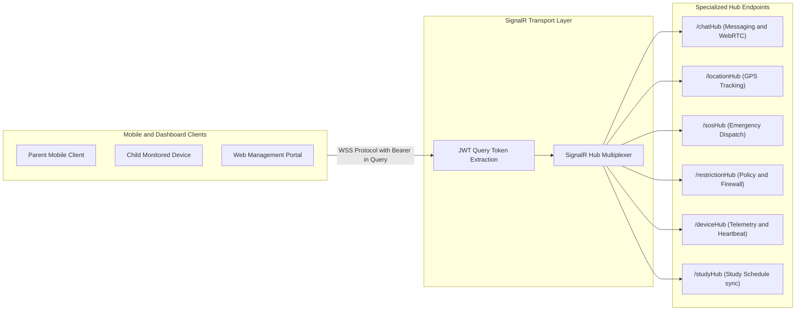

# Realtime Infrastructure and Telemetry Pipeline

## 1. Overview of Realtime Architecture
The QLTE platform leverages **ASP.NET Core SignalR** to provide bidirectional, low-latency communication between mobile applications (Flutter/Android client agents) and the backend API. SignalR abstracts the transport mechanism, negotiating **WebSockets** by default with automatic fallback to **Server-Sent Events (SSE)** or **Long Polling** based on network constraints.



---

## 2. Authentication and Handshake Protocol

Because browsers and native WebSocket implementations cannot always supply standard HTTP `Authorization` headers during connection upgrades, authentication tokens are delivered via the query parameter:

```
wss://api.domain.com/locationHub?access_token=<JWT_TOKEN>&userId=<USER_ID>
```

### 2.1 Backend Token Extraction Hook
ASP.NET Core processes the query string within the `JwtBearerOptions.Events.OnMessageReceived` pipeline hook:

```csharp
builder.Services.PostConfigure<JwtBearerOptions>(JwtBearerDefaults.AuthenticationScheme, options =>
{
    options.Events = new JwtBearerEvents
    {
        OnMessageReceived = context =>
        {
            var accessToken = context.Request.Query["access_token"];
            var path = context.HttpContext.Request.Path;

            if (!string.IsNullOrEmpty(accessToken) &&
                (path.StartsWithSegments("/chatHub") || path.StartsWithSegments("/sosHub")))
            {
                context.Token = accessToken;
            }

            return Task.CompletedTask;
        }
    };
});
```

---

## 3. Hub Specifications and Realtime Events

### 3.1 LocationHub (`/locationHub`)
Dedicated to streaming child GPS coordinates and evaluating boundary adherence.
- **Client Invocations**:
  - `SendLocation(string childId, double lat, double lng)`: Transmits latest geodetic coordinates.
  - `JoinChildGroup(string childId)`: Adds the caller connection to the child tracking room.
  - `LeaveChildGroup(string childId)`: Detaches the caller connection from the room.
- **Server Broadcasts**:
  - `ReceiveChildLocation(string childId, double lat, double lng)`: Relays live coordinate pairs to parents.
  - `ChildLeftSafeZone(object payload)`: Emitted immediately when Haversine evaluation detects a boundary breach.

### 3.2 ChatHub (`/chatHub`)
Facilitates encrypted textual communications and serves as a signaling server for WebRTC peer-to-peer audio/video streaming.
- **Client Invocations**:
  - `SendPrivateMessage(string senderId, string receiverId, string message)`: Persists chat to database and forwards to recipient room.
  - `MarkMessageAsRead(Guid messageId, string readerId)`: Updates message status and alerts sender.
  - `SendOffer(string fromUserId, string toUserId, string sdp, string type)`: WebRTC Offer dispatch.
  - `SendAnswer(string fromUserId, string toUserId, string sdp)`: WebRTC Answer dispatch.
  - `SendIceCandidate(string fromUserId, string toUserId, string candidate, int sdpMLineIndex, string sdpMid)`: WebRTC ICE Candidate candidate exchange.
- **Server Broadcasts**:
  - `ReceivePrivateMessage(Guid messageId, string senderId, string message)`
  - `MessageRead(Guid messageId, string readerId)`
  - `ReceiveOffer`, `ReceiveAnswer`, `ReceiveIceCandidate`

### 3.3 RestrictionHub (`/restrictionHub`)
Manages enforcement signals to child client agents, including firewall state and usage lockouts.
- **Client Invocations**:
  - `JoinDeviceGroup(string deviceId)`: Enrolls child agent into `device-{deviceId}` broadcast room.
  - `CheckConnectionStatus(string deviceId)`: Realtime connectivity health test.
- **Server Broadcasts**:
  - `OnJoinedGroup(object payload)`: Connection verification receipt.
  - `OnRestrictionChanged(object restrictionData)`: Commands child device to reload rules.
  - `OnFirewallToggled(object firewallStatus)`: Realtime signal to activate/deactivate VPN/Firewall filter.

### 3.4 SOSHub (`/sosHub`)
Realtime emergency alarm multiplexer ensuring instant delivery of child distress signals.
- **Client Invocations**:
  - `JoinGroup(string groupId)`: Binds parent or supervisor to child alert stream.
  - `LeaveGroup(string groupId)`: Unbinds connection from alert stream.
  - `SendTest(string message)`: Diagnostic ping for connection verification.
- **Server Broadcasts**:
  - `ReceiveSOS(object payload)`: High-priority distress signal payload including timestamps and coordinates.

### 3.5 DeviceHub (`/deviceHub`) and StudyHub (`/studyHub`)
- `DeviceHub`: Telemetry synchronization, battery levels, network status, remote lock signaling.
- `StudyHub`: Study period activation, exam countdown synchronization, and study mode lock broadcasts.

---

## 4. Geofence Evaluation Engine (Haversine Formula)

The geofence evaluation process compares reported child coordinates against circular safe zones using spherical trigonometry:

$$\Delta\sigma = 2 \arcsin\left(\sqrt{\sin^2\left(\frac{\Delta\phi}{2}\right) + \cos(\phi_1)\cos(\phi_2)\sin^2\left(\frac{\Delta\lambda}{2}\right)}\right)$$

$$d = R \cdot \Delta\sigma$$

Where $R = 6,371,000 \text{ meters}$. If computed distance $d > \text{BanKinh}$, the child is flagged as having breached safe boundaries, triggering state persistence and instant broadcast.

---

## 5. Fault Tolerance and Connection Lifecycle

1. **Keep-Alive Interval**: SignalR heartbeats operate with default 15-second intervals. Missing 2 consecutive intervals initiates disconnect evaluation.
2. **Exponential Backoff Reconnection**: Mobile clients are instructed to adopt backoff intervals: `[0s, 2s, 5s, 10s, 30s]`.
3. **Idempotent Group Registration**: Upon reconnection, clients re-issue `JoinGroup` / `JoinChildGroup` commands to rejoin their assigned channels without losing session context.
