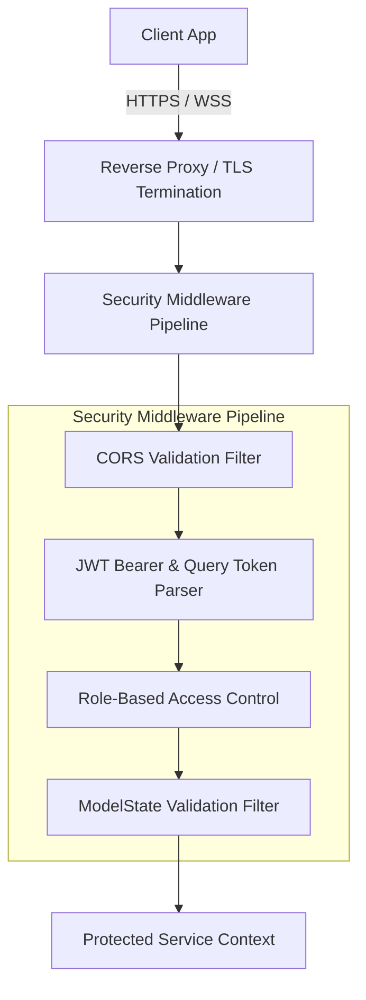

# State Management, Security Architecture, and Governance

## 1. Security Philosophy
The platform implements a Zero-Trust security approach across client applications, background background telemetry, and administrative endpoints. Data in transit is enforced via TLS 1.3/HTTPS, while sensitive credentials and cryptographic keys are isolated using ASP.NET Core Data Protection and dedicated key vaults.



---

## 2. Authentication and Identity Architecture

### 2.1 JWT (JSON Web Tokens) Implementation
- **Algorithm**: HMAC-SHA256 (`HS256`)
- **Key Length**: Minimum 256 bits (32+ characters) configured in `AuthOptions:Jwt:SecretKey`.
- **Payload Claims**:
  - `sub` / `NameIdentifier`: User GUID.
  - `email`: User registered email address.
  - `role`: System security roles (`Parent`, `Admin`, `Children`).
  - `jti`: Unique token identifier preventing replay attacks.
- **Token Expiry**: Default access token lifespan is configurable (defaulting to 60 minutes).

### 2.2 Refresh Token Rotation and Revocation
To mitigate the risk of long-lived access tokens, authentication issues paired short-lived JWTs with cryptographically secure, random 64-character refresh tokens.
- **Storage**: Stored in `AuthDb.RefreshTokens` table with expiration timestamps, `IsRevoked` flags, and audit records.
- **Rotation**: Every successful `/api/Auth/RefreshToken` operation invalidates the prior token and yields a brand-new token pair.
- **Immediate Revocation**: Calling `/api/Auth/UserLogOut` or `/api/Auth/RevokeToken` immediately revokes the active chain.

### 2.3 External Identity Verification (Google OAuth2)
External Google accounts submit ID tokens acquired via Google Play Services to `/api/Auth/ExternalProviderLoginUserToken`. The server validates these tokens directly against Google's public keys via `GoogleJsonWebSignature`. Local system claims and roles are then layered on top of the validated Google identity.

---

## 3. Role-Based Access Control (RBAC) Matrix

Access permissions are enforced declaratively at the controller action level using ASP.NET Core `[Authorize(Roles = "...")]` attributes:

| Resource Scope | Admin | Parent | Children | Anonymous |
|---|---|---|---|---|
| `/api/Auth/LoginUserToken` | Supported | Supported | Supported | Supported |
| `/api/Auth/RefreshToken` | Supported | Supported | Supported | Supported |
| `/api/User/GetListUser` | Supported | Not Applicable | Not Applicable | Not Applicable |
| `/api/Role/*` | Supported | Not Applicable | Not Applicable | Not Applicable |
| `/api/Child/CreateChild` | Supported | Supported | Not Applicable | Not Applicable |
| `/api/SafeZone/*` | Supported | Supported | Not Applicable | Not Applicable |
| `/api/DangerZone/*` | Supported | Supported | Not Applicable | Not Applicable |
| `/api/DeviceInfo/LockDevice` | Supported | Supported | Not Applicable | Not Applicable |
| `/api/DeviceInfo/UpdateStatus` | Supported | Supported | Supported | Supported |
| `/api/DeviceRestriction/*` | Supported | Supported | Not Applicable | Not Applicable |
| `/api/SOSRequest/Create` | Supported | Supported | Supported | Not Applicable |
| `/api/Message/*` | Supported | Supported | Supported | Not Applicable |
| `/locationHub` | Supported | Supported | Supported | Not Applicable |
| `/restrictionHub` | Supported | Supported | Supported | Not Applicable |

---

## 4. SignalR Realtime Channel Protection

Realtime endpoints present unique authentication challenges because WebSocket handshakes do not consistently support custom HTTP headers:
1. **Query Token Security**: Tokens are sent via the `access_token` query parameter over encrypted TLS connections.
2. **Channel Group Isolation**: Hubs enforce room separation (`Groups.AddToGroupAsync`). Clients cannot broadcast or join arbitrary rooms; child telemetry is strictly scoped to `childId` or `device-{deviceId}` groups.
3. **Identity Verification**: Hub methods verify that the caller is authorized to act on behalf of the declared `senderId` or `childId` before persistence or relay.

---

## 5. Network and Perimeter Defense

### 5.1 Cross-Origin Resource Sharing (CORS)
The backend enforces explicit origin whitelisting in `Program.cs`. Permitted origins are restricted to configured development dashboards, web clients, and production application domains:
```csharp
options.AddPolicy("AllowFrontend", policy =>
{
    policy
        .AllowAnyHeader()
        .AllowAnyMethod()
        .AllowCredentials()
        .WithOrigins(
            "http://localhost:5500",
            "http://127.0.0.1:5500",
            "http://10.0.2.2:5074",
            "https://10.0.2.2:5001"
        );
});
```

### 5.2 Model Validation and Injection Defense
- **Filter**: All controller requests run through `ValidateModelAttribute`. If `ModelState.IsValid` is false, requests are intercepted before reaching application business logic, returning standardized 400 Bad Request payloads.
- **SQL Injection Defense**: All database queries are executed via Entity Framework Core parameterized LINQ queries, preventing raw SQL concatenation.
