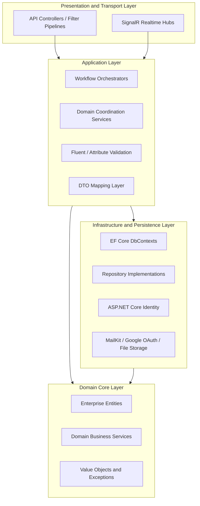
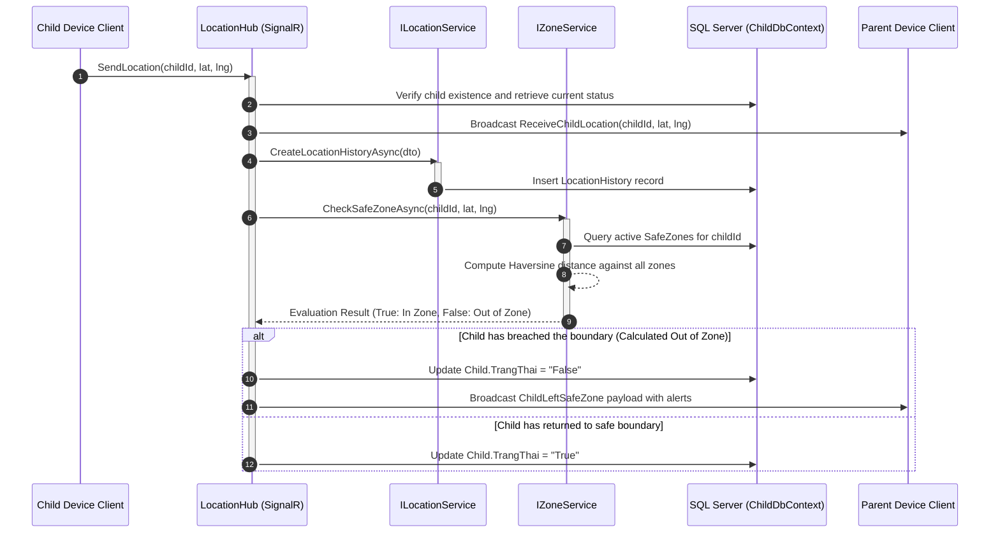
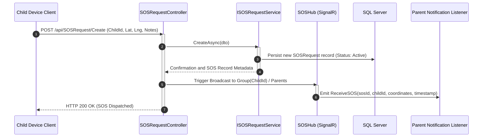

# System Design and Architecture Specification

## 1. Architectural Philosophy
The QLTE backend platform is engineered using a Modular Monolith architecture governed by Domain-Driven Design (DDD) principles and Clean Architecture separation of concerns. The platform balances high decoupling between business sub-domains while maintaining unified deployment ergonomics under ASP.NET Core 8.

---

## 2. Service Domain Decomposition

The application divides domain responsibilities into three bounded contexts alongside a shared infrastructure library:

### 2.1 AuthService Module
- **Purpose**: Identity credential validation, token issuance, refresh token rotation, and identity lifecycle events.
- **Key Capabilities**:
  - JWT token minting and signature validation.
  - Refresh token persistence with revocation tracking.
  - Multi-factor validation and email verification via MailKit.
  - External OAuth2 provider integration (Google Identity).

### 2.2 UserService Module
- **Purpose**: User account lifecycle management, parental profile registry, and role-based access control (RBAC).
- **Key Capabilities**:
  - User profile creation, profile updates, and avatar media binding.
  - Role management (Parent, Admin, Children).
  - Integration with ASP.NET Core Identity for secure password hashing and claims management.

### 2.3 ChildService Module
- **Purpose**: Child lifecycle management, device enrollment, safety geofencing, usage restrictions, and emergency escalation.
- **Key Capabilities**:
  - Geofencing and coordinate analysis using the Haversine mathematical algorithm.
  - Device inventory management, telemetry heartbeat tracking, and remote locking controls.
  - Device restriction orchestration (study mode, application blocking, web domain firewall).
  - SOS dispatch, automated parent broadcast, and peer-to-peer signaling mediation.

### 2.4 Shared.FileStorage Module
- **Purpose**: Unified filesystem management, static asset persistence, slugification, and media integrity checks.
- **Key Capabilities**:
  - Safe file writes with extension whitelisting and path normalization.
  - Slug generation for Vietnamese Unicode strings.

---

## 3. End-to-End Workflow Sequence Diagrams

### 3.1 Realtime Location Telemetry and Geofence Boundary Check
The sequence below illustrates the lifecycle of a location ping dispatched by a child device to the server:

### 3.2 SOS Emergency Alarm Dispatch Workflow
The sequence below illustrates the critical path executed when an emergency SOS button is activated by a child device:

---

## 4. Database Context Separation Architecture

The platform isolates persistence concerns across three logical SQL Server database instances or connection profiles:

1. **AuthDb**: Houses identity security artifacts, authentication logs, and refresh token states.
2. **UserDb**: Stores user account structures, credential metadata, roles, and administrative assignments.
3. **ChildDb**: Contains high-frequency transactional data including `LocationHistory`, `SafeZones`, `DangerZones`, `DeviceInfo`, `DeviceRestrictions`, `ChatMessages`, and `SOSRequests`.

Separation ensures that operational database load from location polling and chat does not impact core user authentication throughput.
